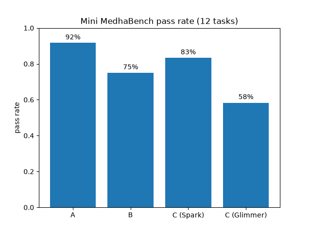
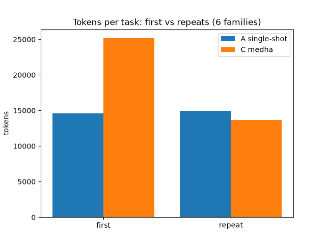
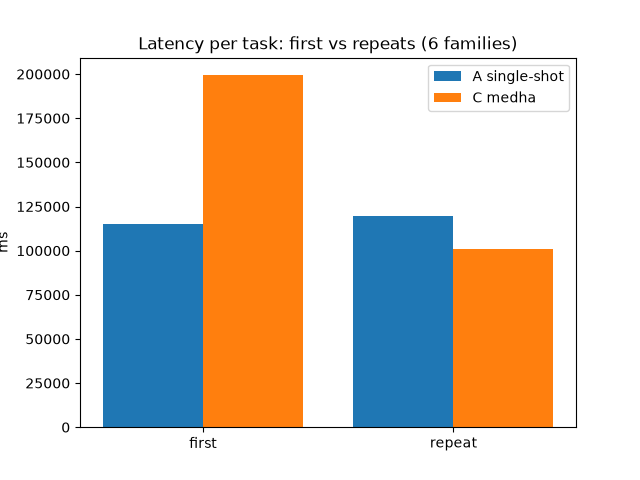
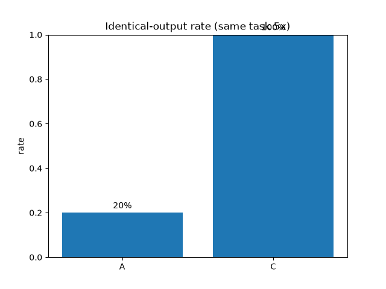
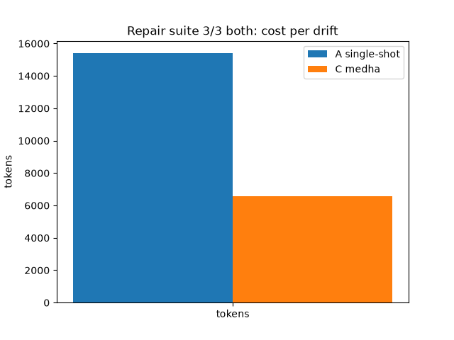

# Medha — skills that stick

Medha is a self-improving agent: it turns recurring chores into **verified,
versioned, executable skills**, then reuses, repairs, and composes them — so
it gets cheaper, faster, and more reliable with use. Built during the Meta
Global AI Developer Hackathon with **Meta Muse Glimmer** (open weights,
self-hosted on Modal), **Muse Spark 1.3** (cross-model judge), and **Modal
Sandboxes**.

The full build spec is [docs/MEDHA_SPEC.md](docs/MEDHA_SPEC.md); pinned
decisions are in [docs/DECISIONS.md](docs/DECISIONS.md).

## Quickstart

```powershell
cp .env.example .env          # fill in keys (mirrors Modal Secret "medha-secrets")
uv sync
uv run pytest -q
uv run modal deploy medha/glimmer.py   # brain; set GLIMMER_BASE_URL after
uv run python -m medha.smoke           # Glimmer + Meta API + sandbox checks
uv run modal deploy medha/deploy.py    # API
uv run python -m bench.run --config all
cd web; pnpm i; pnpm dev               # UI (proxies /api to localhost:8000)
```

## Results (mini MedhaBench, 12 tasks, 6 families)

Configs: **A** single-shot baseline · **B** single-shot + markers ·
**C** full Medha (learn → verify → reuse → repair). Authors: Spark 1.3
(C-Spark) and self-hosted Glimmer-30B (C-Glimmer); judge always Spark 1.3.
Regenerate: `uv run python -m bench.final_report`.



| config | pass | note |
|---|---|---|
| A single-shot | 11/12 (92%) | strong once, pays full price every time |
| B + markers | 9/12 (75%) | markers alone don't help |
| C Medha/Spark | 10/12 (83%) | misses learn once, reuses forever |
| C Medha/Glimmer | 7/12 (58%) | all 5 fails were Modal 503 cold-starts, not authoring |

Pass rate alone hides the value: A re-solves every task from scratch.
The reuse economics are where Medha wins.

**Reuse economics** (each family 3x; repeats = 2nd/3rd sight).
C pays to learn once (25.2k vs 14.6k tokens on first sight), then reuses:




| repeats (12) | tokens | latency | pass |
|---|---|---|---|
| A re-solves | 14,965 | 119 s | 11/12 |
| C HIT reuse (10/12) | **5,704** | **36 s** | **10/10** |

2.6x fewer tokens, 3.3x faster, 100% vs 92% pass. The 2 non-reused
repeats learned fresh (owner_v2/v3, 46k/61k tok) after owner_v1 failed
on a forced-HIT — the failure that taught the D27 guard.

**Consistency** (same task 5x): A returns 5 different outputs
(identical-output rate 0.2); C reuses the verified skill for 5 identical
outputs (rate 1.0, all 5 digests identical).



**Repair** (3 drift cases: renamed column, date format, currency symbols):
both 3/3, but C repairs the versioned skill instead of re-solving —
15.4k → 6.6k tokens (2.3x), 125 s → 48 s (2.6x) per drift.



**Glimmer note:** the open-weights author went 3/12 → 7/12 after the
D25/D26 gate hardening, with zero gate escapes; the remaining 5 fails
all exceeded the 6-minute 503 retry budget (scale-to-zero cold starts).
3 of the 7 passes ran through registered skills (incl. a genuine
zero-author-call HIT reuse); 4 passed via the unverified single-shot
fallback. Next: keep-warm during bench runs.

## Architecture

Every task flows through one pipeline; every state change is an appended event
(spec §4.7 — history is never mutated):

```
task ─▶ planner ─▶ router ─┬─ HIT ──────────────────────────────▶ execute
                            │   (verified skill, 0 author calls)
                            ├─ MISS ─▶ learner ─▶ gate ─▶ judge ─▶ approve ─▶ execute
                            │                      │  ▲               ▲
                            ├─ DRIFT ─▶ repairer ──┘  │               │
                            │                         │               │
                            └─ PARTIAL ─▶ composer ───┘               │
                                              (fuses 2+ skills)       │
                                                      approvals for new skills
```

- `medha/core/` — orchestrator, planner, router (BM25 + LLM rerank +
  Beta pick), learner, repairer, composer, reward, lessons, drift probe.
- `medha/verify/` — the gate: static scan → visible tests → holdout tests →
  outcome shape check → cross-model judge → replay. The test writer never sees
  skill code; holdout tests and the judge are import- and path-firewalled
  from author-side code (`tests/test_firewall.py` enforces this), so authors
  can't reward-hack the graders.
- `medha/llm/` — the single LLM choke point. Author-side roles run on
  self-hosted Glimmer-30B (Modal, OpenAI-compatible); the judge always runs
  on Muse Spark 1.3, so a different model grades the work. Budgets, retry,
  and the DEMO_MODE record/replay cache live here.
- `medha/sandbox/` — pinned image + Modal Sandbox runner. The only place
  generated skill code ever executes (network-blocked).
- `medha/store/` — SQLite event log + skill/version registry + Beta stats.
- `medha/api/` — FastAPI + SSE event stream; `medha/deploy.py`,
  `medha/glimmer.py` — Modal apps.
- `bench/` — MedhaBench tasks, fixtures, checkers, runner, charts.
- `web/` — React UI (chat + pipeline, library, evidence).

## Security model (short)

Generated code runs only in network-blocked Modal Sandboxes. The test
writer never sees skill code; holdout tests and the judge are import- and
path-firewalled from author-side code (`tests/test_firewall.py` enforces
this). Secrets live only in `.env` / Modal Secrets, never in prompts, logs,
or skills.
